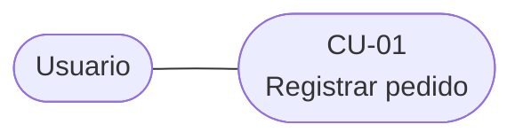

# Ver, clasificar y traducir imágenes

Procedimiento para que el agente vea las imágenes de un documento y deje en formato editable los diagramas, los cuadros y los gráficos. El resultado es `figuras/inventario.md`, con el original y la traducción lado a lado. Después, el documento toma de ahí lo que necesita y le da el formato del prompt de estilo.

**Regla que manda sobre todo lo demás: no se inventa contenido.** Solo se transcribe lo que se ve en la imagen. El contexto del JSON ayuda a clasificar y a titular, pero no completa lo que no se lee.

## 1. Extraer

Antes de extraer: si el documento puede tener datos de personas o de una institución, preguntar al usuario si la carpeta de salida se versiona, y registrar la respuesta según `memoria.md`. Si no se versiona, la salida va fuera del repositorio.

```bash
python3 <carpeta-de-este-skill>/scripts/extraer_imagenes.py documento.docx --salida <carpeta-salida>/figuras/extraidas
```

La entrada es un `.docx`, un PDF o una carpeta con esos archivos o con imágenes sueltas. Un archivo de imagen no se acepta como entrada directa: para procesar la versión en PNG de algo que quedó sin extraer, se lo pone en una carpeta. Solo usa la biblioteca estándar; leer PDF requiere PyMuPDF (`pip install pymupdf`). Si la entrada no existe, tiene otro formato o está corrupta, el script no escribe nada y sale con 2; en una carpeta, basta un documento corrupto para que pase esto, y el mensaje dice cuál es.

Cada nueva ejecución usa una carpeta nueva, porque renumera los `img-NNN` y no borra los archivos viejos. El inventario se rehace contra el `inventario.json` de esa carpeta.

Filtra antes de la lectura visual (DEC-013). Una imagen es mínima si su lado menor mide menos de 32 px (DEC-014); `--lado-minimo` cambia el umbral en una ejecución.

`inventario.json` tiene estas listas:

| Lista | Qué trae | Qué hacer |
|---|---|---|
| `imagenes` | Cada imagen, una sola vez, con `id`, `archivo`, `origen` (`incrustada`, `pagina_vectorial` o `archivo`), `documento`, `ubicacion`, `formato`, `ancho_px`, `alto_px`, `sha256`, `referencias`, `leyenda`, `texto_alternativo`, `parrafo_anterior`, `parrafo_siguiente`, `otras_referencias`, y `parte` (parte del .docx) o `pagina` (página del PDF) | Seguir con la sección 2 |
| `descartadas` | Imágenes mínimas y copias de otra (`igual_a`), con `documento`, `ubicacion` y `motivo` | Pasarlas al inventario, sin leerlas |
| `no_extraidas` | Formas y gráficos dibujados por Word, formatos sin lectura visual (EMF, WMF, BMP, TIFF, SVG…) y referencias externas, rotas o sin relación, con `documento`, `ubicacion`, `tipo`, `motivo`, `referencias`, su contexto y, si corresponde, `texto` o `destino` | Pasarlas al inventario y avisar al usuario: si alguna importa, tiene que dar una versión en PNG |
| `avisos` | Lo que quedó sin procesar o hay que revisar: un PDF sin PyMuPDF, documentos de otro formato en una carpeta, OOXML estricto o páginas de PDF con muchos trazos rectos | Informarlos al usuario |

Detalles para leer bien el JSON:

- `leyenda` es un candidato: se completa si un párrafo tiene estilo de leyenda o empieza como «Figura N» o «Tabla N», y puede tomar el título de una tabla o texto corrido. Se confirma mirando la imagen y sus vecinos. Muchos documentos no usan ese estilo y ponen el título en el párrafo anterior y la nota en el siguiente: por eso hay que mirar siempre los dos párrafos vecinos. Con dos figuras seguidas, un vecino puede ser de la otra figura.
- `referencias` cuenta las veces que el documento muestra la imagen. Las de `mc:Fallback` no cuentan, porque repiten lo que Word muestra por otra vía. Con `referencias: 0`, el archivo está en el documento, pero puede no mostrarse o estar solo en `mc:Fallback`: se lee igual y se avisa al usuario.
- Una página vectorial de PDF es una imagen de toda la página: se traduce solo el dibujo, no el texto corrido de alrededor. Puede ser un falso positivo (por ejemplo, una página con muchos adornos); en ese caso se la clasifica como captura y se lo anota.
- Una página de PDF con muchos trazos rectos no se convierte, y sus números quedan en un aviso del documento: se revisan, porque puede ser una tabla o un diagrama ortogonal. Si es un diagrama, se le pide al usuario la página en PNG.

## 2. Leer

Abrir cada archivo de `imagenes` con la herramienta Read y mirarlo. No se clasifica ni se traduce nada a partir del nombre del archivo, de la leyenda o de los párrafos vecinos. Si el agente no puede ver imágenes, se detiene acá y lo avisa. Si Read no abre un archivo, se lo pasa a Avisos del inventario con su `id`, sin clasificarlo, y se sigue con los demás.

Una imagen muy grande puede llegar reducida: si el texto se ve mal, se amplía la zona en una copia temporal antes de darlo por ilegible.

## 3. Clasificar

Cada imagen recibe un solo tipo:

| Tipo | Cómo se reconoce |
|---|---|
| Diagrama de contexto | Un sistema central con entidades alrededor y flujos de entrada y salida |
| Diagrama de secuencia | Participantes arriba, líneas de vida y mensajes ordenados de arriba hacia abajo |
| Diagrama de casos de uso | Actores, óvalos y, en general, un recuadro de límite |
| Diagrama de flujo | Pasos y decisiones unidos por flechas con un orden |
| Organigrama | Áreas o cargos en jerarquía, con conectores de dependencia |
| Diagrama ER | Entidades con atributos o cardinalidades |
| Diagrama de despliegue | Nodos, servidores o entornos con componentes adentro |
| Cuadro o tabla | Filas y columnas de texto, dibujadas como imagen |
| Gráfico de datos | Barras, líneas, tortas o similares, con valores |
| Captura de pantalla | Una interfaz real de un programa |
| Foto | Una fotografía |
| Logo | Una marca o un escudo |

Un diagrama sin fila propia, como BPMN, se traduce con `flowchart` y la marca «aproximación» según DEC-012, sin preguntar. Una imagen en notación C4 se clasifica por lo que muestra: contexto o despliegue. Se pregunta solo si no se sabe qué es la imagen o si se duda entre dos tipos que se traducen distinto, y se registra según `memoria.md`.

## 4. Traducir

| Tipo | Traducción | Marca |
|---|---|---|
| Secuencia | Mermaid `sequenceDiagram` (DEC-011) | — |
| Flujo | Mermaid `flowchart` | — |
| ER | Mermaid `erDiagram` | — |
| Contexto | Mermaid `flowchart` | aproximación (DEC-012) |
| Casos de uso | Mermaid `flowchart`, con los actores y los casos como nodos `(["…"])` y el límite como `subgraph` | aproximación (DEC-012) |
| Organigrama | Mermaid `flowchart TB` | aproximación (DEC-012) |
| Despliegue | Mermaid `flowchart`, con cada nodo como `subgraph` | aproximación (DEC-012) |
| Cuadro o tabla | Tabla Markdown | — |
| Gráfico de datos | Tabla Markdown con los datos, más una especificación: tipo de gráfico, ejes, unidades y series | — |
| Captura, foto o logo | Queda como imagen: sin traducción | — |

Los tipos C4 y `architecture` de Mermaid no se usan: son experimentales o beta.

Al traducir:

- Mermaid es la fuente editable, no una copia del dibujo. No busca reproducir colores, tipografía ni el estilo de lámina (DEC-011): eso se resuelve después, con el prompt de estilo.
- Se conserva todo lo que se lee, tal como está: títulos, subtítulos, números de mensaje, guardas de `alt`, `loop` y `opt`, leyenda y notas. Lo que no tiene lugar en el diagrama va en las observaciones del inventario.
- No se corrigen errores del original ni se reemplazan nombres de personas por roles. Si el documento final necesita otra cosa, se pregunta (DEC-007, pregunta 3).
- **Gráficos**: si no imprime los valores, no se leen del eje: el valor queda `[PENDIENTE: ilegible]`, y lo que se aprecia (tendencia, orden) va en las observaciones.
- **Tablas**: una celda combinada repite su texto en cada celda que cubre, y se anota en las observaciones. La marca de lo ilegible va dentro de la celda. La barra se escribe `\|`.
- Los textos de `flowchart` y de las entidades y relaciones de `erDiagram` van entre comillas dobles: `A["Texto (con paréntesis)"]`. Un salto de línea es `<br/>`. Las comillas dentro de un texto se escriben `#quot;`, y en `sequenceDiagram` el punto y coma se escribe `#59;`.

### Lo ilegible

Lo que no se lee queda como `[PENDIENTE: ilegible]`, en el lugar exacto donde falta, aunque el contexto permita adivinarlo:

```text
flowchart LR
  A(["Actor"]) --- B(["CU-01<br/>[PENDIENTE: ilegible]"])
  A -->|"[PENDIENTE: ilegible]"| C["[PENDIENTE: ilegible]"]
```

- Si se lee una parte, se transcribe esa parte: `"[PENDIENTE: ilegible] pedido"`.
- En `sequenceDiagram` la marca se escribe sin comillas: `participant B as [PENDIENTE: ilegible]` y `A->>B: [PENDIENTE: ilegible]`. En las entidades y relaciones de `erDiagram`, con comillas: `"Dirección" ||--o{ "[PENDIENTE: ilegible]" : "tiene"`.
- Un atributo de `erDiagram` no admite comillas en el nombre, y la marca va en su comentario: `string calle "[PENDIENTE: ilegible]"`. Si no se lee el nombre, se usa uno provisorio: `string pendiente_1 "[PENDIENTE: ilegible]"`. Un nombre con tilde se escribe tal cual (`string dirección`); si tiene espacios, se unen con `_` y el original va en el comentario.
- Si no se ve adónde llega una línea, el extremo es un nodo pendiente. No se la conecta con el candidato más probable.
- Un párrafo vecino o la leyenda pueden sugerir el texto: se mencionan en las observaciones del inventario, nunca dentro de la traducción.

## 5. Asignar la confianza

Cada traducción lleva una sola confianza. Si se duda entre dos, se elige la más baja:

| Confianza | Definición |
|---|---|
| Alta | Se leyó todo el texto y todas las relaciones, sin dudas. No tiene ningún `[PENDIENTE: ilegible]`. |
| Media | La estructura es segura, pero hay algún `[PENDIENTE: ilegible]` o alguna lectura dudosa en elementos aislados. Las dudas se listan en las observaciones. |
| Baja | Falta o es dudosa una parte importante: buena parte del texto no se lee, o no se sabe con certeza qué se conecta con qué. La traducción no se usa sin revisión del usuario. |

Las capturas, las fotos y los logos llevan «no aplica»: no tienen traducción.

## 6. Validar y escribir el inventario

Antes de cerrar, se comprueba que cada Mermaid se renderice. `mmdc` no es una dependencia del agente; se usa a mano:

```bash
npx @mermaid-js/mermaid-cli -i figuras/inventario.md -o <carpeta-temporal>/inventario.md
```

Si `mmdc` no corre, el inventario queda «sin validar» en su primera línea y se avisa al usuario. Un bloque que sigue sin compilar después de corregirlo queda como imagen, con su texto en las observaciones y confianza baja.

El inventario va en `figuras/inventario.md`. Es una hoja de trabajo: el verificador lo ignora al recorrer una carpeta, y sus pendientes se informan aparte. Mermaid no entra en una celda de una tabla Markdown, así que cada imagen usa una tabla HTML:

````markdown
# Inventario de figuras

## img-001: Título tal como se lee en la imagen

- **Tipo:** diagrama de casos de uso
- **Confianza:** media
- **Marca:** aproximación
- **Origen:** documento.docx, word/media/image1.png (1 referencia)
- **Observaciones:** el nombre del segundo actor no se lee.

<table>
<tr><th>Original</th><th>Traducción</th></tr>
<tr>
<td valign="top"></td>
<td valign="top">



</td>
</tr>
</table>

## Descartadas

| Documento | Ubicación | Motivo |
|---|---|---|

## No extraídas

| Documento | Ubicación | Tipo | Motivo | Contenido |
|---|---|---|---|---|

## Avisos
````

Reglas del formato:

- **Las líneas en blanco alrededor del bloque `mermaid` o de la tabla Markdown son obligatorias**, y no se les pone sangría. Sin ellas, el contenido se ve como texto plano.
- La marca es la palabra «aproximación» cuando corresponde y «—» si no.
- Una captura, una foto o un logo lleva en la celda de traducción: «Queda como imagen».
- Un gráfico lleva en la celda su tabla y, debajo, su especificación.
- La columna Contenido de «No extraídas» copia `texto` o `destino`: lo legible de una forma no se pierde.

Límites conocidos de la vista:

- **VS Code**: la vista previa arma la tabla y muestra la imagen, pero no dibuja Mermaid sin una extensión (por ejemplo, *Markdown Preview Mermaid Support*). Sin ella, a la derecha se ve el código y no el dibujo.
- **GitHub**: la imagen relativa solo se ve si la carpeta `extraidas/` está en el repositorio. Si eso no corresponde (ver la sección 7), a la izquierda queda el texto alternativo.

## 7. Informar

Al terminar, se informa al usuario:

1. Cuántas imágenes hay por tipo y por confianza.
2. Las de confianza baja y cada `[PENDIENTE: ilegible]`, con su `id`.
3. Lo descartado, lo no extraído y los avisos.
4. El estado de validación de los Mermaid: validados con `mmdc`, o «sin validar» y por qué.
5. Cualquier caso no definido, registrado según `memoria.md`.

Las imágenes y el inventario pueden tener nombres y datos de personas o de una institución. Quedan en el repositorio del proyecto solo si el usuario lo decidió (sección 1), y nunca en el repositorio del agente, ni siquiera como fixtures de tests.
