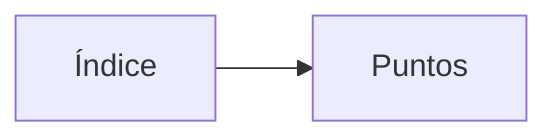

# 2 Requisitos

La Tabla 2.1 enumera las condiciones, y la Figura 2.1 muestra el recorrido de lectura.

**Tabla 2.1.** Condiciones de la entrega

| Condición | Motivo |
|---|---|
| Un índice | Ordena la lectura |
| Un archivo por punto | Separa los temas |

**Figura 2.1.** Recorrido de lectura

## 2.1 Numeración

Cada archivo numera sus tablas y sus figuras con su propio prefijo. La Tabla 2.2 da un ejemplo.

**Tabla 2.2.** Ejemplo de prefijos

| Archivo | Prefijo |
|---|---|
| Punto 2 | 2 |
| Punto 3 | 3 |
